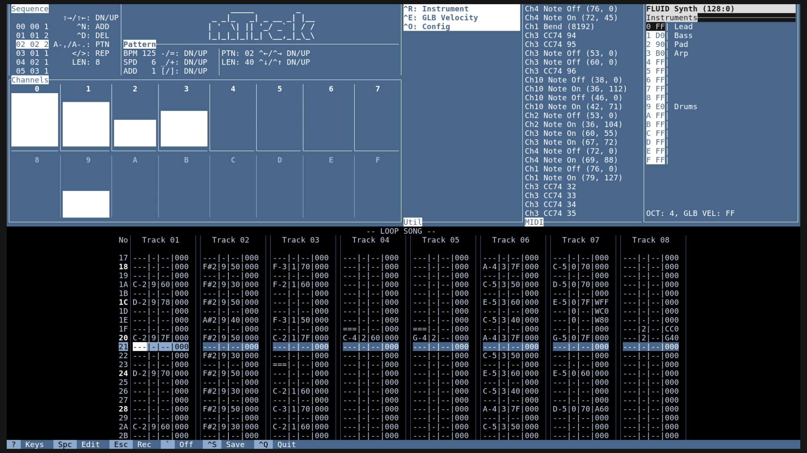

# mTrak

A lightweight MIDI tracker for the terminal.

mTrak is modelled on FastTracker 2: the same pattern editor layout, piano keyboard
mapping and navigation keys. Instead of playing samples it sends MIDI, so it can drive
any hardware or software synth.



## Features

- Windows, Mac and Linux
- Full TUI with total keyboard control
- Pattern editor with 8 tracks per pattern, FT2-style keyboard note entry and navigation
- Song sequence with per-pattern repeats
- MIDI output on all 16 channels, with one instrument per channel and a per-instrument volume
- Command column for (midi) effects, CC, CC slides, velocity slides, aftertouch and pitch bend
  (see [docs/COMMANDS.md](docs/COMMANDS.md))
- Pattern and song playback, looping or once through for recording
- Per-channel activity meters, channel muting and a MIDI event monitor
- Built-in file browser for saving projects, with Save As and folder creation
- Context-aware key hints in the footer, dialogs and file browser
- FT2 color theme on truecolor terminals, a 16-color theme on Windows consoles and macOS
  terminals without truecolor, and a monochrome fallback
- ASCII mode for terminals or fonts without Unicode box drawing and symbols

## Installation

### From a release

Download the binary for your platform from the
[releases page](https://github.com/TheExiledCat/mTrak/releases) and put it somewhere on
your `PATH`.

### From source

You need a recent stable Rust toolchain (install it with [rustup](https://rustup.rs)).
On Linux you also need the ALSA development headers, e.g. `libasound2-dev` on
Debian/Ubuntu or `alsa-lib-devel` on Fedora.

```sh
cargo install --git https://github.com/TheExiledCat/mTrak
```

Or from a local clone:

```sh
git clone https://github.com/TheExiledCat/mTrak
cd mTrak
cargo install --path .
```

## Usage

```sh
mtrak                  # start with an empty project
mtrak song.mtrak       # open a project
```

Pick a MIDI output port with `Ctrl+O`. mTrak makes no sound on its own, so connect it to a physical (or virtual) midi device to make music.

### Options

| Option                         | Description                                                    |
| ------------------------------ | -------------------------------------------------------------- |
| `--color <mono\|ansi16\|full>` | Force a color theme instead of detecting one from the terminal |
| `--ascii-mode`                 | Draw with ASCII characters only                                |

Setting `NO_COLOR` or `TERM=dumb` also selects the monochrome theme.

## Config

Projects are saved to an `mtrak` folder in your music folder by default, but you can save
and open them from any folder. Global settings live in an `mtrak` folder in your config
folder. Both are created on startup if they don't exist yet.

| Platform | Projects                    | Config                                |
| -------- | --------------------------- | ------------------------------------- |
| Linux    | `~/Music/mtrak`             | `~/.config/mtrak`                     |
| macOS    | `~/Music/mtrak`             | `~/Library/Application Support/mtrak` |
| Windows  | `%USERPROFILE%\Music\mtrak` | `%LOCALAPPDATA%\mtrak`                |

On Linux the music folder follows `XDG_MUSIC_DIR` and the config folder follows
`XDG_CONFIG_HOME`, if they're set.

**NOTE** Currently the project file format is non stable as its still being developed. This can mean depending on your mtrak version u might not yet be able to open older project formats, mtrak will give you an error when trying. When release v1.0.0 is finished, the file format will be stabilized and backwards compatability will be added.

## Roadmap

Planned features, in no particular order:

- [x] **File browser and global saving**
- [ ] **Undo system**
- [ ] **MIDI file import/export**
- [ ] **MIDI input**
- [ ] **MIDI clock out**: send clock and start/stop to sync external sequencers, drum machines and arpeggiators
- [ ] **Multiple output ports**: map instruments to different MIDI devices, not just channels on one port
- [ ] **Program change and bank select per instrument**, so loading a project restores the right patches
- [ ] **Panic button**: all notes off and reset controllers, for stuck notes
- [ ] **Live record**: play notes in while the song is playing, for beatmaking
- [ ] **Row lock edit**: option to stop the cursor following the playback row, so you can edit a pattern while it plays (handy for loops)
- [ ] **Block operations**: select, copy, paste and transpose across rows and tracks
- [ ] **Swing/groove**, per pattern or global
- [x] **Prebuilt binaries** for Linux, Windows and macOS on every release
- [ ] **More commands**
    - [ ] Roll
    - [ ] Roll with volume glide
    - [x] Tempo (BPM) and speed change (`F`)
    - [ ] Note delay
    - [ ] Note probability
    - [ ] Shorthand commands for common CCs (mod wheel, filter cutoff, etc.)
- [ ] **Autosave and crash recovery**
- [ ] **Custom themes**
- [ ] **Keyboard remapping**, with default layouts per OS/shell
- [ ] **Proper CLI argument parsing** and a global app config
- [ ] ...and more

Have an idea? Feel free to open an issue.

## Contributing

Bug reports, feature requests and pull requests are welcome. See
[CONTRIBUTING.md](CONTRIBUTING.md) for how to get started and
[docs/CONVENTIONS.md](docs/CONVENTIONS.md) for the code style. Run `./fmt.sh` before
committing to format the code and apply lint fixes.
